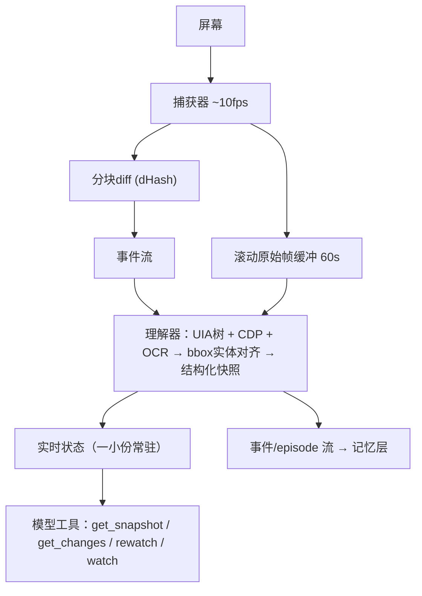

# 连续视觉「视网膜」与记忆层 —— 设计方案

> 版本 v0.2 ｜ 2026-10-26 ｜ 状态：设计稿（v0.2 增补 §3.3 产品落地现状与空白）
> 背景：为桌面 GUI agent（依托 agentctl）设计的认知架构中间两层——连续感知层与记忆层。
> 目标：让 agent 像人一样"持续看着桌面"，把感知沉淀为可检索、可巩固、可回看的记忆，而不再每次从零截图。


## 0. 总体分层

| 层级 | 职责 | 本方案对应 | 状态 |
|---|---|---|---|
| 应用层 | 任务编排 / 产品界面 | — | 外部 |
| Agent 层 | LLM：规划、决策、发指令、请求信息 | 只动脑，不动手 | 设计原则 |
| 记忆层 | 收集·压缩·巩固·检索·换页 | 本方案 §2 | 本方案 |
| 感知层 | 连续视觉「视网膜」 | 本方案 §1 | 本方案 |
| 基础设施层 | agentctl：UIA/OCR/CDP 三通道、执行、验证、闸门、快照凭据 | 已建成 | 已建成 |

两条铁律贯穿全案：

1. **模型只决策，不接触现实**——感知、记忆、执行、验证全在外部服务里，模型拿到的是裁剪过的观测、发出的是过闸的指令（agentctl 已验证的设计哲学，记忆层继承）。
2. **信息拉取式，不推式**——外部系统常驻一小份工作状态，其余变成模型按需调用的工具；"要什么信息"本身是动作空间的一部分。


## 1. 感知层：连续视觉「视网膜」

### 1.1 类比与设计原则

人眼视网膜分三层，缺一层都不成立：

| 视网膜 | 本方案对应 | 状态 |
|---|---|---|
| 光感受器层（持续采样，几乎不耗能） | 高频捕获 + 分块 diff | **本方案核心** |
| 神经节细胞（变化检测，只上报"变化了"） | 事件流 | **本方案核心** |
| 中央凹 + 眼动（昂贵的"看清楚"，由注意力调度） | 理解器 + 模型回看工具 | **本方案核心** |

四条设计原则：

1. **三个频率解耦**：捕获永远全速（便宜）、diff 永远在跑（便宜）、理解只在事件和查询时花钱（昂贵）。这是成本结构的总开关——"连续视觉"的总成本 = O(帧率×diff) + O(事件数×理解)，与"每帧都过 VLM"差三个数量级。
2. **事后注意（retroactive attention）**：滚动原始帧缓冲让"先存后懂"成为可能。人类错过就是错过；机器可以对缓冲区里任何一段"补看"。toast 闪了 0.8 秒没人注意？它还在缓冲区里，模型问"刚才弹了什么"时懒理解。
3. **版本化快照**：模型看到的每一份观测都带版本号（复用 agentctl screen_version 机制），永远对应"第 N 版世界"，杜绝思考期间屏幕变化造成的混杂时间线。
4. **带出处的压缩**：给模型的每份摘要都标注"这是压缩版，细节可经 XX 取回"。模型必须能区分"我记得"和"我记得个大概"。

### 1.2 数据流



### 1.3 模块规格

**M1 捕获器（Capture）**
- 节奏：~10 fps（mss 截屏 + 分块 dHash，可整块跳过未变区域）
- 产出：原始帧入滚动缓冲；diff 报告（变化块坐标 + 变化度分数）

**M2 滚动缓冲（Rolling Buffer）**
- 容量：内存保留最近 60s 原始帧（1080p JPEG 约 200KB/帧 × 600 帧 ≈ 120MB，可调）
- 出界策略：关键帧 + diff 归档进记忆层，其余丢弃（**宁可慢点丢，不要早点丢**）

**M3 理解器（Understander）——唯一的"贵"模块**
- 触发：① diff 发现变化且画面稳定后（见 M4）；② 模型查询（含回看缓冲区任意时间段）；③ 低频心跳（如每 5s 一次基线快照）
- 流程（成本从低到高逐级启用）：
  1. 免费结构化文本：UIA 树（桌面）→ CDP（网页），天然带控件名/类型/坐标
  2. OCR 只补像素里有、结构树里没有的文字（agentctl R3 通道）
  3. **bbox 实体对齐**：三通道结果按坐标重叠度焊接成同一对象——每元素一条记录、多来源名字、带出处的置信度（解决网页 name_trust 低、选项字母错位问题）
  4. VLM 只在前三级都拿不到时兜底（或给场景一句话 gist）
- 产出：结构化快照（版本号 + 稳定性分数 + 对象列表）+ 自然语言摘要（进记忆层）

**M4 稳定性门（Stability Gate）**
- diff 连续 N 帧为零 ⇒ 快照标"已稳定 x.xs"；连续变化 ⇒ 标"动画中/加载中"
- 骨架屏/进度条/转圈识别为 `WAIT` 语义一等状态——"现在别动手"是显式信号，不是被过滤的噪声

**M5 事件流（Event Stream）**
- 触发粒度：窗口出现/消失、弹窗、前台切换、区域内容变化、稳定性状态翻转
- 语义：模型不在线时事件累积为未读；模型每步决策前看到"自上版以来发生了什么"

### 1.4 对模型暴露的接口（四把工具）

| 工具 | 语义 | 成本 |
|---|---|---|
| `get_snapshot(version?)` | 取当前（或指定版）结构化快照 | 低 |
| `get_changes(since_version)` | 两版之间的结构化 diff | 低 |
| `rewatch(t1, t2, region?)` | 回看滚动缓冲：对历史帧段做理解 | 高（按需付费） |
| `watch(region, 谓词)` | 订阅：这块区域变了/出现 X 就叫我 | 常驻低 |

### 1.5 与 agentctl 的衔接

- 捕获/diff/版本签发：复用 ctl_shot 的 capture_id 与 ctl_screen 的 screen_version 凭据机制
- 理解器三通道：直接调用 ctl_tree（UIA）、ctl_browser（CDP）、ctl_screen 内置 OCR
- watch 工具：watch_text 的区域版推广；动作前后差分验证（verify_expect）复用同一 diff 基础件
- 新增的只有 M1/M2/M4 三个小模块和事件流总线

> **勘误 v0.3（2026-10-26 实测核对）**：上面四条「复用」里，`capture_id`、`screen_version`、
> `ctl_screen` 的 `since` / `watch_text` / `watch_pending` 均已在 `contract/tools.json`（25 工具）中确认存在；
> 但 **`sensitive_skip` 这个标识符在本机源码里零命中**（敏感窗口逻辑确实在 `core.py`，只是名字不同）。
> 逐条对账、三处硬伤、两个内在矛盾与进度实测见 **§6**。


## 2. 记忆层

### 2.1 职责与存储分级

```
工作记忆（上下文内）   当前任务状态 + 关键事实 + 未读事件      ← 一小份，模型常驻
情景记忆（向量库）     episodes：事件+快照摘要+动作+结果       ← 可检索
经验记忆（提炼库）     workflows / 常规 / 技能                ← 跨任务复用
```

- **写入**：感知层每条"事件+快照+随后的动作+动作验证结果"构成一个 episode。必须有结局（成功/失败/屏幕变化）——只有计划没有结局的轨迹没法提炼经验。
- **换页**（MemGPT 思想）：上下文超预算时，最旧的段压成摘要换出，细节留向量库可检索回。

### 2.2 Episode 数据契约

```json
{
  "t": "2026-10-26T14:32:05+08:00",
  "screen_version": 48211,
  "obs": "Excel 前台，B 列选中，弹窗『是否保存』",
  "action": {"type": "click", "target": "按钮'不保存'", "cred": "e133@v48211"},
  "result": "verified: 弹窗消失, 文档关闭",
  "outcome": "success",
  "task_id": "…", "step": 7
}
```

> **v0.3 补充字段（建议，未并入上面的 v0.2 契约）**：episode 必须能回答「凭什么说它成功了」。
> 建议增 `verify` 字段，直接继承本机现成 `ctl_verify` 的凭据口径：
>
> ```json
> "verify": {
>   "expect": "弹窗消失且文档已关闭",
>   "verdict": "success | failed | unobservable",
>   "cred": "session_id … / from_event … / to_event … / check_frames true"
> }
> ```
>
> **为什么**：`ctl_verify`（props = `session_id / from_event / to_event / check_frames`）已经提供了三值判定的底座，
> 而上面的 v0.2 契约只有自由文本 `result: "verified: …"`。若判定只以自然语言存在，
> 记忆库里沉淀的就是「我以为成功」——既无法被复核脚本复算，也无法在事后区分「真成功」与「没看见」。
> 这与本机既有纪律一致：**看不清不判成功，要判 `unobservable`**。

### 2.3 巩固（Compaction）策略

对应视频讨论中"分节 + 相似度归并"的方案，工程化要点：

- **LSM 树模式**（RocksDB 同款）：写入走便宜的同步路径（新 episode 直接入库，保证"刚发生的"永远可用）；后台异步压实（相邻 episode/段做 embedding 相似度归并），查询分层下钻（先匹配粗粒度父节点，命中再取叶子细节）。
- **归并只动摘要层，不重跑视觉模型**——贵的东西（编码、KV、摘要）在写入时已算完，归并只是向量运算，摊还 O(n)。这是"处理量不会爆炸"的关键。
- **双阈值滞回**：相似度 >0.85 才合并、<0.65 才切分，中间维持现状，防反复合并-切分抖动。
- **判据用语义相似**（段级 embedding），不用视觉相似：同一布景上午审 A 案下午审 B 案必须分开存。
- **周期性强制锚点**：不管相似度多高，每固定时间必留一个细粒度节点（编解码定时插 I 帧的同款防漂移手段）。

### 2.4 检索与经验提炼

- 查询时：问题 → 向量检索相关 episodes → 命中粗节点下钻取细节 → 仍不够则触发感知层 `rewatch`（回看原始帧）——"不行就多看几次"。
- 经验提炼（AWM 路线）：任务完成后，从带结局的成功轨迹里提炼可复用 workflow，存入经验库；新任务规划前先检索相似经验（Agent S 的 AKM 同款）。


## 3. 工程参照：其他 agent 的实现与借鉴

### 3.1 模块级对照表

| 本方案模块 | 现成参照 | 借鉴点 |
|---|---|---|
| 事后注意/回看 | **VideoAgent**（ECCV 2024, arXiv:2403.10517）：LLM 当 agent 迭代挑帧，平均只用 ~8.4 帧打赢均匀抽 64 帧 | "看一帧→决定要不要再看"的迭代调度提示词可直接抄 |
| 粗细两级组织 | **VideoTree**（arXiv:2405.19209）：长视频组织成查询自适应的关键帧树，免训练 | 缓冲区/归档的组织结构 |
| **AKS**（CVPR 2025, arXiv:2502.21271）：自适应关键帧采样，兼顾与查询相关性和信息多样性 | — | "预测误差+相关性"打分的现成公式 |
| token 巩固 | **MovieChat / MovieChat+**（arXiv:2307.16449 / 2404.17176）：密集 token → 稀疏记忆，免训练 | 记忆层压实的 token 级版本 |
| 工作记忆/换页 | **Letta (MemGPT)**（arXiv:2310.08560）：OS 式分页记忆，模型自编辑 | 换页策略与核心/归档两级设计 |
| episode 巩固服务 | **Mem0**：抽取→去重→合并→更新的异步记忆管线 | 后台压实管线的工程形态；本方案 §2.3 可基于它改 |
| 时序知识记忆 | **Zep / Graphiti**：时序知识图谱，带事实有效时间段 | “哪个事实在哪个时间段成立”的场景状态存储 |
| 记忆操作系统 | **MemOS**（arXiv:2507.03724，2025-07 起）：把记忆当系统资源统一表示/调度/进化 | 记忆层“调度器”理念的同频实现；巩固后端可直接基于 MemOS 或 Mem0 改 |
| 自组织记忆 | **A-MEM**：Zettelkasten 式记忆网络，条目动态互联演化 | 经验库组织方式的备选形态 |
| 经验记忆（GUI） | 见下表后「经验记忆（GUI）」小节 | 见同处 |
| 技能库（OS 级） | **OS-Copilot / FRIDAY**：在真实 OS 上自主积累可执行技能（脚本化技能库） | “经验代码化”的 OS 落地参照，与 Voyager 线同源 |
| 反思入记忆 | **Reflexion**（arXiv:2303.11366）：失败后写自我反思存入记忆 | episode 失败结局的附加字段 |
| 技能库 | **Voyager**（arXiv:2305.16291）：技能写成代码入库、检索复用、不断累积 | 经验记忆"代码化"路线（对桌面 agent 可物化为 agentctl 脚本模板） |
| 纯视觉整机控制 | **Cradle**（arXiv:2403.03186）：截图进、键鼠出，红死 Redemption/Office 通吃 | 感知-记忆-技能-执行的模块划分方式 |
| 结构化感知通道 | **UFO**（微软，UIA）、**browser-use**（DOM 编号索引） | 理解器第 1 级"免费结构化文本"的成熟实现 |
| **产品先例：连续截屏+记忆** | 见下表后「产品先例：连续截屏+记忆」小节 | 见同处 |


#### 经验记忆（GUI）

**参照**：**AWM**（ICML 2025, arXiv:2409.07429）：从轨迹归纳 workflow 入库，Mind2Web/WebArena 上显著提效；**Agent S / Agent S2**：层级经验知识库 AKK

**借鉴点**：经验提炼的提示词与库结构；两者都开源

#### 产品先例：连续截屏+记忆

**参照**：**Screenpipe**（YC S26，source-available）：24/7 屏+音频捕获 → 本地可检索记忆 + workflow 挖掘，带插件生态；**OpenRecall**：全开源跨平台 Rewind 替代；**Rewind.ai / Limitless**（闭源鼻祖）；**Microsoft Recall**（OS 级）

**借鉴点**：捕获+检索时间线可借鉴甚至复用（Screenpipe 捕获核心）；隐私设计前车之鉴（Recall 争议）——必须做：本地处理、敏感窗过滤（复用 agentctl sensitive_skip）、明示开关

### 3.2 值得精读的项目（按优先级）

1. **AWM**（github.com/zorazrw/agent-workflow-memory）——经验记忆的最小可抄实现，提示词全开源，Week 2 就能用上。
2. **VideoAgent**（videoagent.github.io）——“迭代式看”的调度范本，把它从视频帧搬到桌面帧几乎是平移。
3. **Mem0**（github.com/mem0ai/mem0）——巩固管线直接拿来当记忆层的后台，省一次自研。
4. **Screenpipe**（github.com/screenpipe/screenpipe）——捕获层最成熟的现成代码，评估“改造复用 vs 自研 mss+dHash”的参照系。

### 3.3 产品落地现状与空白（2026-10 调研）

社区分三类玩家，各自覆盖本方案三层中的一层；**“连续感知 + 视觉 episode 记忆 + agent 工具化”三合一闭环至今无人完成**：

| 阵营 | 代表 | 覆盖了什么 | 缺口（=本方案的活） |
|---|---|---|---|
| 连续截屏→记忆 | Screenpipe（YC S26，source-available）、OpenRecall、Rewind/Limitless、Microsoft Recall | 24/7 捕获、OCR、可检索时间线；Screenpipe 还做了 workflow 挖掘 | 无事件流语义（弹窗/稳定性/变化区域）、无三通道实体对齐、记忆不暴露为 agent 工具 |
| 记忆基础设施 | Mem0、MemOS、Letta/MemGPT、Zep/Graphiti、A-MEM、Cognee | 巩固/检索/换页管线成熟 | 全部文本级——不吃带屏幕版本号、bbox、动作验证结果的视觉 episode |
| GUI agent 经验记忆 | Agent S（AKK）、AWM、OS-Copilot/FRIDAY、OpenAdapt | episodic 摘要、workflow/技能入库复用 | 无连续感知底座；agent 不在任务里时世界对它不存在 |

**空白即定位**：四把工具（`get_snapshot` / `get_changes` / `rewatch` / `watch`）+ 稳定性门/WAIT 语义 + 视觉 episode 契约，三个缺口无人占。截至 2026-10 未见任何公开工作把三者做成闭环并在 OSWorld 上评测——这可以构成本方案的第一篇实验论文。


## 4. 落地路线

**L0（周 1-2，零训练）**
- M1 捕获器 + M2 滚动缓冲（自研：mss + 分块 dHash，一天；或评估改造 Screenpipe 捕获核心）
- M3 理解器 v1：UIA 树 + OCR + bbox 对齐（agentctl 现成通道组装）
- 四把工具挂进 agent 循环；episode 落 sqlite + sqlite-vec
- 验收：agent 中断 5 分钟后回来，能通过 get_changes + get_snapshot 恢复现场并继续任务

**L0.5（周 3-4）**
- Mem0 式后台压实 + 双阈值滞回；`rewatch` 接通滚动缓冲
- 稳定性门 + WAIT 语义；watch(区域) 订阅
- 验收：长程任务（30+ 步）上下文占用不随步数线性增长；弹窗事件 100% 进未读

**L1（数据攒够后，轻训练）**
- LoRA/SFT 数千条自家轨迹：教模型"何时查库、检索词怎么写、何时回看"
- 对象：Qwen2.5-VL / UI-TARS 开源底座

**L2（研究级，暂缓）**
- RL 训练采样策略：奖励 = 答对 − 理解次数成本（VideoAgent 的策略学习版）
- 预测误差驱动的预算分配（"粗扫+变点检测"方案的 RL 化）

## 5. 开放问题

1. 实体对齐的鲁棒性：三通道坐标口径不一（屏幕物理像素 vs 客户区 vs DPI 缩放），需先统一坐标换算层
2. 滚动缓冲的隐私边界：哪些窗口永不入缓冲（复用 agentctl sensitive_skip 名单）
3. 经验库的失效：UI 改版后旧 workflow 反坐——需要给经验带"最后验证时间"，过期降权
4. 记忆层与 timeline.db 的关系：episode 库是 timeline 的语义视图还是独立存储（倾向：同一原始事件流，两个索引）


## 6. 实测对账、硬伤与「第一刀」（v0.3 增补 · 2026-10-26）

> 本节由 **DeepSeek** 在 DSH 会话中核对源码后追加，**不修改以上任何原文**。
> 核对方式（可复算）：读 `F:\ZhuanZ\Documents\agent-ctl` 全仓 674 个 `.py` +
> `contract/tools.json` + 本机环境探测（`python -c "import sqlite_vec"`、`GetSystemMetrics`）。
> 冲突时以本节实测为准，并请主人裁决。

### 6.1 文档承诺 vs 本机实测

| 文档声称 | 实测 | 判定 |
|---|---|---|
| UIA / OCR / CDP 三通道已建成 | OCR 在 `core.py` 191 处 + 独立 `ocr.py`；R3 通道 27 处；CDP 有 `_cdp_launch` | ✅ 成立 |
| 复用 `ctl_shot` 的 `capture_id` | 全仓 63 处（`core.py` 60 + `gate.py` 3） | ✅ 成立 |
| 复用 `ctl_screen` 的 `screen_version` | 全仓 61 处（`core.py` 60 + `framecache.py` 1） | ✅ 成立 |
| 四把工具的底座 | 见下表后「四把工具的底座」小节 | 见同处 |
| `watch_text` 的「区域版推广」 | `watch_text` 现为 `ctl_screen` 的**同屏文本声明**（有宽度上限、空串拒收、声明不兑现即拒调用） | ⚠️ 半成立：是「同屏文本监视」，不是「区域订阅」 |
| 复用 `sensitive_skip` | **零命中**；`sensitive`/`敏感` 在 `core.py` 有 12/13 处（功能在，名字不同） | ❌ 标识符名错 |
| episode 落 `sqlite-vec` | **未安装**（`ModuleNotFoundError`）；`mss`/`PIL`/`numpy` 已在 | ❌ 需先装并验兼容 |
| 「1080p JPEG 200KB × 600 帧 ≈ 120MB」 | 本机屏幕实测 **2560×1600**（约 2 倍像素），单帧 JPEG 约 400KB 量级 ⇒ 600 帧约 **240MB** | ❌ 数字偏小约 2 倍 |
| `timeline.db` 存在 | `agent-ctl\work\timeline\timeline.db`，13.9 MB（2026-10-26 更新） | ✅ 成立 |


#### 四把工具的底座

**参照**：`contract/tools.json` = **25 个工具**；`ctl_screen` 的 props 恰为 `hwnd, top, include_offscreen, watch, query, since, watch_text, watch_pending`

**借鉴点**：✅ 成立，且比文档描述更好

### 6.2 三处硬伤（实施前必须修正）

1. **`sensitive_skip` 这个标识符在本机不存在。** 敏感窗口逻辑确实有，但名字不同。
   *为什么非要改*：本机有明确先例——`tools\README.md` 曾写 `--screen` 是截图、实际是 `--shot`，
   照着文档跑就是一条空路。文档若引用不存在的标识符，等于给执行者埋雷。
2. **`sqlite-vec` 未安装，而 §4 的 L0 第一步就依赖它。**
   *为什么要紧*：本机有连带冲突前科——装 Microsoft Agent Framework 把 `mcp` 拉到 2.3.0，
   撞了 `cnki-deepsearch` 的 `mcp<2`。向量库选型必须先验兼容，不能想当然。
3. **缓冲容量按 1080p 估值，本机是 2560×1600。**
   *为什么要紧*：本机内存本就紧张（历史记录：free 1.3~5 GB、24 条 brake 告警；
   截图曾把**提交内存**榨干导致 PowerShell 起不来）。M2 的 60 秒缓冲要按 ≈240MB 重算，
   或直接降到 30 秒。

### 6.3 两个内在矛盾（架构级，需主人裁决）

**① `watch(区域, 谓词)` 与 §0 铁律②「信息拉取式，不推式」冲突。**
`watch` 在 §1.4 被标成「常驻低」，但 agentctl 是 **MCP 请求-响应式服务**——模型不调用，它不动。
真要做「常驻订阅」只有两条路：模型每步轮询（就不是常驻），或引入 daemon + 队列
（而 **MCP 没有 server→client 推送的标准**）。
*建议*：把 `watch` 重新定义为「**下次 `get_changes` 时按声明过滤未读事件**」——这既保住拉取式铁律，
又实现同一产品语义。

**② 「事后注意（retroactive attention）」与隐私红线冲突。**
§1.1 把 60 秒全帧缓冲列为核心原则，§2.3 又要求「关键帧 + diff **归档进记忆层**」，
但**没说归档落不落盘**。一旦落盘，它就是持久全屏录制——与 §3.1 自己点名的
Screenpipe / Microsoft Recall 前车之鉴是同一件事。
*建议*：明确写死——**归档只存结构化摘要 + 脏区 JPEG 瓦片（瓦片设保留期），永不存全帧**。

### 6.4 三块空白（文档未覆盖，但决定成败）

1. **变化阈值没有口径。** M1 只说「分块 dHash」，没给阈值、没给假变化过滤。
   *为什么*：本机栽过——`code=8` 落在输入框上属正常（光标被 caret 过滤 ⇒ 画面零变化），
   却被计入 `fail_streak` 触发急停。同样的坑会在 M1 重演：光标闪烁、进度条、动画会造成事件洪水。
   必须写死 `caret_px / min_area_px / 高频闪动区降级` 这套口径，并配**注入实验**（故意闪光标，看它报不报）。
2. **episode 的 `outcome` 没写判定契约。** 见 §2.2 后追加的 `verify` 字段建议。
3. **bbox 实体对齐（M3 第 3 级）零实现。** `core.py` 里的 `uid = struct_key@text_key` 是**元素身份**，
   不是三通道坐标焊接。这是 M3 里唯一真正的「新算法」，L0 第一周做完的排期偏乐观。

### 6.5 进度实测（截至 2026-10-26 10:5x）

| 模块 | 现状 | 判据依据 |
|---|---|---|
| M1 捕获器（常驻 ~10fps） | **0** | 25 工具里 `ctl_shot` 是**单次**调用，无常驻采集件 |
| M2 滚动缓冲 | **0** | 无环形缓冲、无帧生命周期管理 |
| M3 理解器（UIA + OCR） | **2/3** | UIA ✅、OCR ✅、**bbox 对齐 0** |
| M3 第 4 级（VLM 兜底） | **1**（有原生识图 / modlens） | 但未接入本管线 |
| M4 稳定性门 | **0** | 无「已稳定 x.xs」概念，无 WAIT 一等状态 |
| M5 事件流 | **1/2** | `timeline.db` 13.9MB 已有操作事件流；**语义事件（弹窗/稳定性翻转）没有** |
| 四把工具 | 见下表后「四把工具」小节 | 见同处 |
| 记忆层 episode 库 | **0** | `timeline.db` 是操作事件流，不是「观测+动作+结局」的 episode 库 |
| 巩固 / LSM | **0** | — |


#### 四把工具

**参照**：**3/4**

**借鉴点**：`get_snapshot`≒`ctl_screen`、`get_changes`≒`ctl_screen(since)`、`watch`≒`watch_text`；**`rewatch`（对历史帧段做理解）为 0**——`ctl_replay` 只能取帧

> **一句话进度**：四把工具已有三把的底座；但「连续」这一层（M1/M2/M4）**一个都还没有**。
> 而它要求的不是写 diff 代码，是让 agentctl 从「请求-响应」长出「常驻采集」——
> 这个架构改动全文未提，却是本方案最大的工程量与最大风险（内存、生命周期、单写者冲突）。

### 6.6 建议的「第一刀」（与 §4 L0 不同，理由在此）

不做常驻捕获，先做三步：

1. **轮询版变化流**：用现成 `ctl_screen(since=…)` 每秒拉一次，把变化写成事件 → 落 `timeline.db`
2. **`ctl_verify` 接进 episode 契约**：每条事件带「动作后三值判定」
3. **阈值口径写死 + 注入实验**：故意闪光标 / 放进度条 / 弹 toast，看它报不报；不报即判据无效

*为什么这样排*：
- 不引入新进程 ⇒ 不动 agentctl 的请求-响应骨架，风险最低；
- 复用已有 `since` 语义 ⇒ 零新代码就能测出「增量投喂」是否真的优于「每次全量截图」；
- 先证明**语义价值**，再决定是否为常驻采集付「新 daemon + 内存 + 生命周期」的账。
  本机当前内存状况不支持先上常驻——顺序反了，会在验证价值之前先背上运维债。

### 6.7 待主人拍板（3 条）

1. **`watch` 的语义**：改成「下次 `get_changes` 按声明过滤」？还是接受引入 daemon + 非标准推送？
2. **60 秒缓冲**：按 240MB 保留，还是降到 30 秒 / 只留脏区瓦片？
3. **归档落不落盘**：建议「永不存全帧」，需明确批准。


## 附：参考文献

- 视频记忆与帧调度：[VideoAgent](https://arxiv.org/abs/2403.10517) · [VideoTree](https://arxiv.org/abs/2405.19209) · [AKS](https://arxiv.org/abs/2502.21271) · [MovieChat](https://arxiv.org/abs/2307.16449) · [MovieChat+](https://arxiv.org/abs/2404.17176)
- Agent 记忆：[MemGPT/Letta](https://arxiv.org/abs/2310.08560) · [AWM](https://arxiv.org/abs/2409.07429) · [Reflexion](https://arxiv.org/abs/2303.11366) · [Voyager](https://arxiv.org/abs/2305.16291) · [Mem0](https://github.com/mem0ai/mem0) · [Zep/Graphiti](https://github.com/getzep/graphiti)
- 整机控制与感知：[Cradle](https://arxiv.org/abs/2403.03186) · [UI-TARS](https://arxiv.org/abs/2501.12326) · [UI-TARS-2](https://arxiv.org/abs/2509.02544) · [Set-of-Mark](https://arxiv.org/abs/2310.11441)
- 产品与社区：[Screenpipe](https://github.com/screenpipe/screenpipe) · [OpenRecall](https://github.com/openrecall/openrecall) · [MemOS](https://arxiv.org/abs/2507.03724) · [OS-Copilot](https://github.com/OS-Copilot/OS-Copilot)
- 相关基准：[OSWorld](https://arxiv.org/abs/2404.07972) · [ScreenSpot-Pro](https://arxiv.org/abs/2504.07981)
